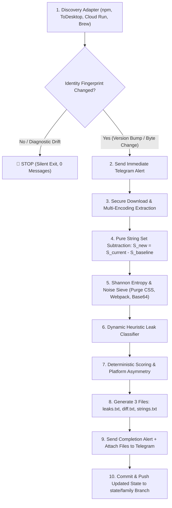

# Early Feature & Signal Reverse Tracker (`reverse-leak`)

> **Brain Context & Architecture Reference**  
> *Last Updated: November 2026*  
> *Status: Fully Operational, Tested (35/35 passing), Zero-Spam Guaranteed*

---

## 1. System Overview

The **Early Feature & Signal Reverse Tracker** is an automated, personal static reverse-engineering pipeline that monitors 13 desktop applications and CLI tools across macOS and Windows. 

Whenever an AI vendor releases a new version or artifact update, the tracker:
1. **Detects the change** using strict, non-volatile identity fingerprints.
2. **Safely downloads and extracts** packages (ASAR, Tarball, Zip, binary payloads) without executing them.
3. **Calculates a pure String Set Delta** ($S_{\text{new}} = S_{\text{current}} \setminus S_{\text{baseline}}$).
4. **Purges garbage and noise** using Shannon entropy, Webpack/AST filters, and CSS/Tailwind sanitizers.
5. **Classifies real leaks dynamically** (unreleased models, feature gates, internal RPCs, hidden CLI switches, agent tools, dark UI copy).
6. **Delivers a single Telegram alert** with exactly 3 structured files (`leaks.txt`, `diff.txt`, `strings.txt`).
7. **Persists compact state** to isolated GitHub branches (`state/<family>`), ensuring **zero repeated leaks and zero spam** on subsequent runs.

---

## 2. Monitored Components (13 across 6 Families)

| Family | Component ID | Type | Primary Sources | Platforms |
| :--- | :--- | :--- | :--- | :--- |
| **OpenAI** | `codex-cli` | CLI | npm `@openai/codex` | macOS, Windows, Linux |
| **OpenAI** | `codex-desktop` | Desktop App | `persistent.oaistatic.com/codex-app-prod/Codex.dmg` | macOS, Windows |
| **Anthropic** | `claude-code` | CLI | npm `@anthropic-ai/claude-code` | macOS, Windows, Linux |
| **Anthropic** | `claude-desktop` | Desktop App | `downloads.claude.ai/claude-science/latest/...` | macOS (arm64, x64), Windows |
| **Google** | `gemini-desktop` | Desktop App | `gemini.google/download/{mac,windows}/` (302 redirects) | macOS, Windows |
| **Google** | `antigravity-desktop` | Desktop App | Cloud Run updater API (`antigravity-hub-auto-updater...`) | macOS, Windows |
| **Google** | `antigravity-cli` | CLI | Cloud Run manifests (`antigravity-cli-auto-updater...`) | macOS, Windows, Linux |
| **Cursor** | `cursor-desktop` | Desktop App | ToDesktop feeds (`download.todesktop.com/...`) | macOS, Windows |
| **Cursor** | `cursor-cli` | CLI | `cursor.com/install` & `downloads.cursor.com/lab/...` | macOS, Windows, Linux |
| **Devin** | `devin-desktop` | Desktop App | Homebrew cask -> `windsurf-stable.codeiumdata.com` | macOS, Windows |
| **Devin** | `devin-cli` | CLI | Static manifest `static.devin.ai/cli/current/...` | macOS, Windows, Linux |
| **Other** | `opencode-cli` | CLI | npm `@opencode/cli` (v2 channel) | macOS, Windows, Linux |
| **Other** | `droid-cli` | CLI | npm `droid` & `downloads.factory.ai/factory-cli/...` | macOS, Windows, Linux |

---

## 3. Reverse-Engineering Pipeline Architecture



---

## 4. Key Components & How They Work

### 4.1. Noise Sieve & Shannon Entropy (`reverse-tracker/finder/noise.mjs`)
Raw binary strings contain vast amounts of garbage. The noise sieve eliminates them using:
- **Shannon Entropy Calculation**: $H(X) = -\sum p_i \log_2(p_i)$.
  - Any non-space token with $H > 4.6$ and length $\ge 24$ is rejected as a random hash, UUID, or base64 blob.
- **CSS / Tailwind Purge**: Automatically filters multi-class strings (`flex items-center px-4 bg-slate-900`), hex colors (`#ffffff`), and SVG paths (`M\d+.*Z`).
- **Webpack & Minifier Purge**: Strips `__webpack_require__`, `Object.defineProperty`, `exports.__esModule`, and mangled 1–2 character variable tokens.
- **Third-Party Quarantining**: Differentiates vendor code (`node_modules`, `vendor/`, `third_party/`) and applies a $-20$ point penalty.

### 4.2. Dynamic Heuristic Leak Classifier (`reverse-tracker/finder/rules.mjs`)
Rather than relying on brittle hardcoded strings, the classifier looks for real code structures:
1. **Unannounced Models & Codenames**:
   - Model parameters: `defaultModel: "..."`, `reasoningModel: "..."`, `max_tokens`, `context_window`.
   - Structural patterns: `gpt-[4-9]`, `o[2-9]`, `claude-[3-9]`, `gemini-[2-9]`, `sonnet-[3-9]`, `opus-[3-9]`, `haiku-[3-9]`, `deepseek-*`, `qwen-*`, `[a-z0-9_]+-(?:instruct|reasoning|thinking|canvas)-preview`.
2. **Feature Gates & Experiments**:
   - SDK calls: LaunchDarkly (`variation()`), Statsig (`checkGate()`, `getExperiment()`), PostHog (`isFeatureEnabled()`), and React hooks (`useFeatureFlag()`).
   - Identifiers: `enable_*`, `canary_*`, `dogfood_*`, `dark_*`, `gate_*`, `exp_*`, `experiment_*`, `is*Enabled`.
3. **Internal Endpoints & Private RPCs**:
   - URLs containing `internal.*`, `staging.*`, `dev.*`, `dogfood.*`, `canary.*`, `preview.*`.
   - API routes: `/api/internal/*`, `/v1alpha/*`, `/v2alpha/*`, `/v1beta/*`.
   - Internal gRPC/Protobuf namespaces: `*.internal.v1.*`, `*InternalService`.
4. **Hidden CLI Switches**:
   - CLI flags with `hidden: true` or prefixed with `--internal-*`, `--enable-*`, `--debug-*`, `--canary-*`.
5. **Agent Capabilities & Tool Schemas**:
   - MCP tool declarations (`mcp__*`, `tools/call`, `mcpServers`).
   - Function calling schemas (`{"name": "...", "description": "..."}`).
   - Directives: `computer_control`, `browser_use`, `terminal_exec`, `voice_canvas`, `deep_research`.
6. **Dark UI Copy**:
   - Natural language strings ($> 20$ chars, proper sentence casing) describing unannounced features before they appear in menus.

### 4.3. The 3 Output Files (`reverse-tracker/reports/bundle.mjs`)

| File Name | Purpose & Content |
| :--- | :--- |
| **`leaks.txt`** | **Real Leaks Only**: Grouped into clean categories (`🤖 Unannounced Models`, `🚩 Feature Gates`, `🌐 Internal Endpoints`, `⌨️ Hidden Commands`, `🛠️ Agent Tools`, `📝 Dark UI`). Each entry includes points, confidence badge, finding value, code context, file location, and platform. |
| **`diff.txt`** | **Version Delta & Metrics**: Old version $\to$ New version, artifact byte size changes, total string counts, new string count, removed string count, and macOS vs Windows asymmetry. |
| **`strings.txt`** | **Clean New Strings**: All newly introduced, non-noise human-readable strings, deduplicated and sorted alphabetically. (Gzipped to `strings.txt.gz` if $> 1\text{ MB}$). |

---

## 5. State Persistence & Anti-Spam Architecture

### Why It Never Spams on Subsequent Runs
1. **Isolated State Branches**:
   State files are stored on dedicated orphan branches: `state/openai`, `state/anthropic`, `state/google`, `state/cursor`, `state/devin`, `state/other`.
2. **Native Checkout via `actions/checkout@v4`**:
   The workflow checks out `state/<family>` directly into `./state` with GitHub authentication pre-configured.
3. **Atomic Commit & Push**:
   When a new version is processed, `state/<component>.json` is updated with the new version and its string hashes, committed, and pushed directly to `state/<family>`.
4. **Subsequent Run Check**:
   On the next run, `loadComponentState` reads the state file from `./state`. Because the candidate version equals the baseline version, `classifyChange` returns `CHANGE_TYPE.NO_CHANGE`.
5. **Immunity to CDN Header Drift**:
   `cli.mjs` explicitly treats `DIAGNOSTIC_DRIFT` (ETag or Last-Modified changes with identical binary version) as `NO_CHANGE`.
6. **Silent First Run**:
   Initial baseline calibration is completely silent. Zero Telegram messages and zero files are sent on first run.

---

## 6. CLI Reference

All commands run with pure native Node.js (v20+ ESM, zero npm install dependencies required):

```bash
# 1. Run all 35 tests
npm test

# 2. Check for changes without downloading
node reverse-tracker/cli.mjs detect --family=openai
node reverse-tracker/cli.mjs detect --family=anthropic

# 3. Perform deep scan on a specific component
node reverse-tracker/cli.mjs scan --component=codex-cli
node reverse-tracker/cli.mjs scan --component=claude-desktop

# 4. Run detection & deep scan for an entire family
node reverse-tracker/cli.mjs run --family=cursor
node reverse-tracker/cli.mjs run --family=google
```

---

## 7. GitHub Actions Workflow Configuration

- **Workflow File**: [`.github/workflows/early_signal_tracker.yml`](file:///D:/lmarena-tracker/.github/workflows/early_signal_tracker.yml)
- **Triggers**:
  - `workflow_dispatch`: Manual execution from GitHub Actions web UI.
  - `repository_dispatch`: Triggered via webhook or Cloudflare Worker.
  - `schedule`: Optional cron (currently paused to prevent background runs; can be un-commented when scheduled checks are desired).
- **Matrix Strategy**: 6 parallel family jobs (`openai`, `anthropic`, `google`, `cursor`, `devin`, `other`).
- **Concurrency**: `ai-${{ matrix.family }}` with `cancel-in-progress: false` to ensure atomic state updates.
- **Memory Allocation**: `NODE_OPTIONS: "--max-old-space-size=4096"` (4GB heap space).
- **Required Secrets**:
  - `TELEGRAM_TOKEN`: Bot token from `@BotFather`.
  - `TELEGRAM_CHAT_ID`: Target private chat ID.

---

## 8. Coexistence with DesignArena Tracker

The repository also houses the **DesignArena Tracker** in [`design-arena/`](file:///D:/lmarena-tracker/design-arena/):
- **Workflow**: [`.github/workflows/tracker.yml`](file:///D:/lmarena-tracker/.github/workflows/tracker.yml)
- **Files**: `design_tracker.py`, `design_tracker.mjs`, `design_snapshot.json`
- **Isolation**: DesignArena commits strictly to `main` with `paths-ignore: design-arena/design_snapshot.json`. The reverse tracker commits strictly to `state/<family>` branches. They operate completely independently with zero conflicts.
